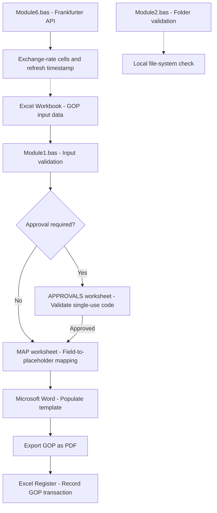

# GOP Generator — Technical Architecture

## 1. System Overview

GOP Generator is a Microsoft Excel VBA automation project designed to support Guarantee of Payment (GOP) administration.

The application combines Excel worksheet operations, Word document automation, PDF generation, approval validation, and currency exchange-rate retrieval.

## 2. System Components

### Module1.bas — GOP Generation

The main VBA module coordinates the GOP generation process.
Its responsibilities include:

- Reading and validating information from Excel.
- Using a hidden `MAP` worksheet to associate Excel fields with Word document placeholders.
- Checking approval requirements against configured thresholds.
- Validating single-use approval codes where required.
- Populating a Word document through VBA automation.
- Exporting the completed document to PDF.
- Updating the relevant Excel register.
- Handling processing errors and cleanup.

The module uses an `APPROVALS` worksheet to support authorization-code validation.

### Module2.bas — Folder Validation

This utility demonstrates folder accessibility checks using VBA.
It includes a demonstration password and a local directory check using Windows environment variables.

### Module6.bas — Exchange-Rate Integration

This module retrieves exchange rates through the public Frankfurter API.
The workflow includes:

1. Reading currency codes from the configured Excel worksheet.
2. Making HTTP requests to retrieve exchange-rate information.
3. Processing the returned data.
4. Updating exchange-rate cells.
5. Recording the latest refresh timestamp.
6. Handling unsuccessful requests and other processing errors.

## 3. Data Flow

## 3. Data Flow

The following diagram illustrates the main GOP generation workflow and supporting modules.

Currency exchange-rate retrieval and folder validation are shown as supporting functions. The diagram represents the conceptual workflow rather than every internal VBA procedure.

## 4. Dependencies

- Microsoft Excel with VBA support.
- Microsoft Word for document generation.
- Windows environment for local file-system operations.
- Internet connectivity for exchange-rate retrieval.
- An appropriately configured Excel workbook and Word template.

## 5. Configuration

The public source code contains demonstration configuration values.

The application depends on specific worksheet names, cell references, mapping tables, and document placeholders.

Users adapting the source code must configure these elements for their own workbook and template.

## 6. Security and Privacy

This repository is intended to demonstrate VBA automation techniques.

- Operational credentials are not included.
- Demonstration passwords must not be treated as secure authentication.
- Patient records and production workbooks are not distributed.
- Internal folder paths have been replaced or anonymized.
- The Word template is not currently included.

## 7. Project Scope

The repository provides VBA source modules for technical reference and portfolio demonstration.

It is not a standalone, ready-to-run application. The original workbook structure and supporting document templates are required for full functionality.
