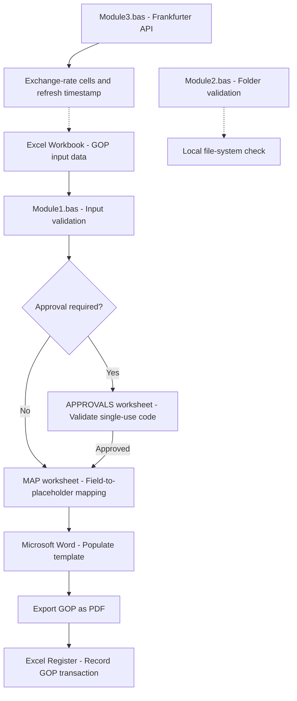

# Architecture

## 1. System Overview

GOP Generator is a Microsoft Excel VBA automation project designed to automate a departmental administrative process. It is built in Excel worksheet with macros (.xlsm file) plus Word document (input), PDF (output) and Frankfurter API currecny exchange retrieval.  

## 2. System Components

### Module1.bas — GOP Generation

Module 1, the main VBA module, coordinates the entire process. This module could actually keep the process running even without the other two modules. It is responsible for reading the data inserted into the FORM, populating the table in the CLIENT sheet, and generating a PDF file as an output, which is the GOP document itself.

### Module2.bas — Folder Validation

This utility demonstrates folder accessibility checks using VBA. It includes a demonstration password and a local directory check using Windows environment variables.

### Module3.bas — Exchange-Rate Integration

This module retrieves exchange rates through the public Frankfurter API. First it reads the currency codes in the Excel worksheet, and then make a HTTP request to retrieve exchange-rate information. It update the ER table and timestamp. 

## 3. Data Flow

The following diagram illustrates the main GOP generation conceptual workflow and supporting modules.

## 4. Dependencies

- Microsoft Excel with VBA support.
- Microsoft Word for document generation.
- Windows environment for local file-system operations.
- Internet connectivity for exchange-rate retrieval.
- An appropriately configured Excel workbook and Word template.

## 5. Configuration

The public source code contains demonstration configuration values.

The application depends on specific worksheet names, cell references, mapping tables, and document placeholders.

Users adapting the source code must configure these elements for their own workbook and template.

## 6. Security and Privacy

This repository is intended to demonstrate VBA automation techniques.

- Operational credentials are not included.
- Demonstration passwords must not be treated as secure authentication.
- Patient records and production workbooks are not distributed.
- Internal folder paths have been replaced or anonymized.
- The Word template is not currently included.

## 7. Project Scope

The repository provides VBA source modules for technical reference and portfolio demonstration.

It is not a standalone, ready-to-run application. The original workbook structure and supporting document templates are required for full functionality.
